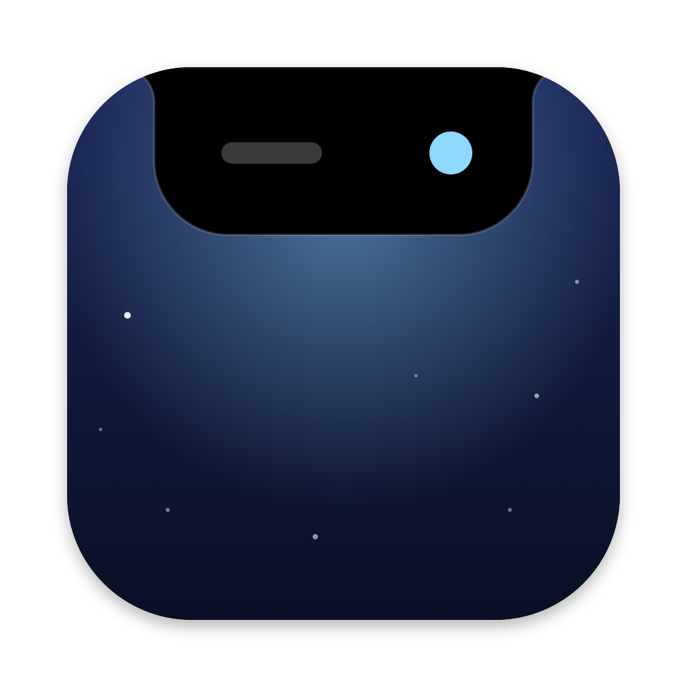
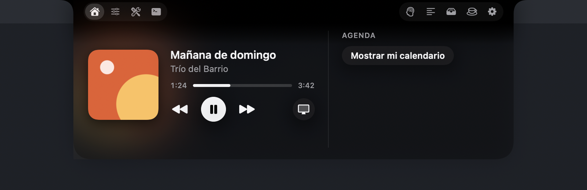
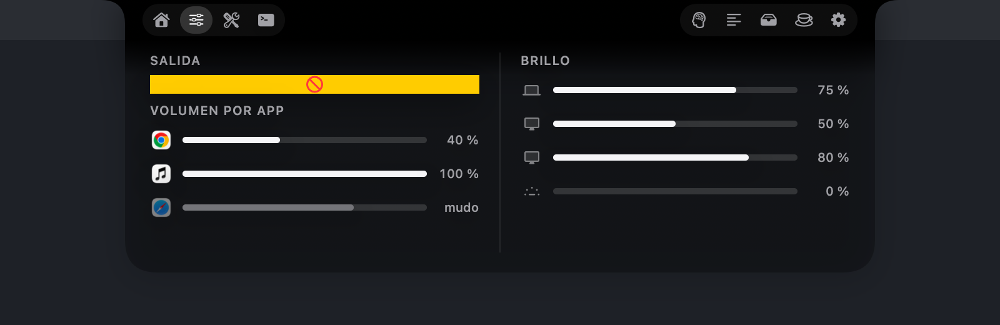
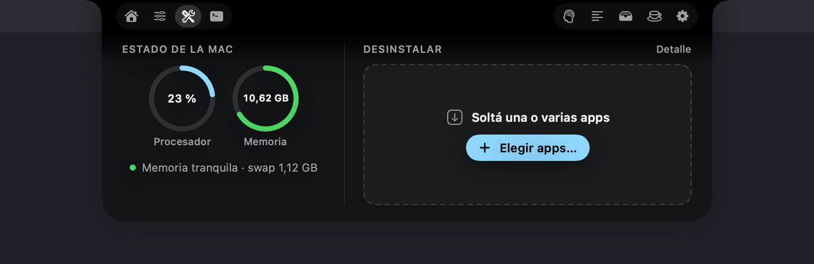
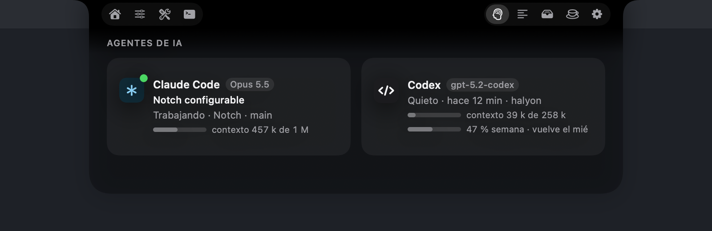
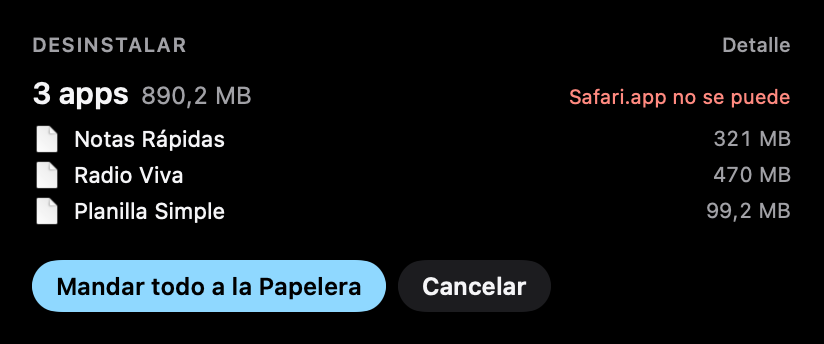
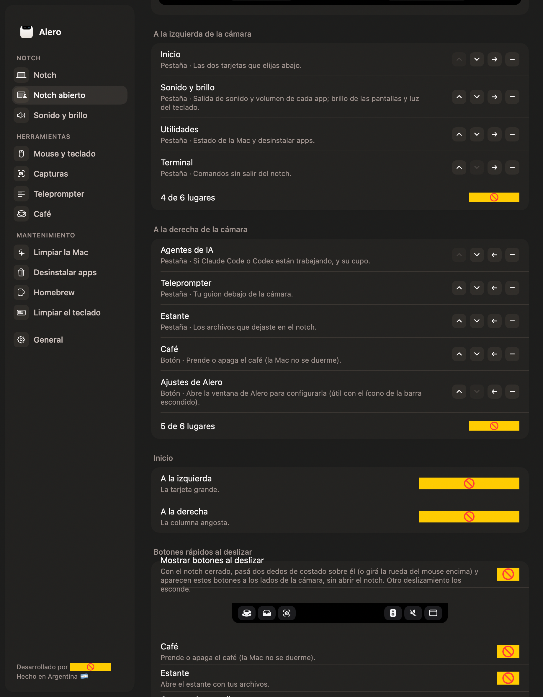

<p align="center"></p>

<h1 align="center">Alero</h1>

<p align="center"><b>El notch de tu Mac, trabajando.</b><br>
Una app nativa para la barra de menú y el notch: música, agenda, volumen por app, brillo de las pantallas,
teleprompter, capturas, limpieza y desinstalador. Liviana, privada y de código abierto.</p>

<p align="center"><a href="https://alero.halyon.app/es/">Sitio</a> · <a href="https://github.com/Halyon85/alero/releases/latest">Descargar</a> · 🌎 <b><a href="README.md">Read in English</a></b></p>

---

| Inicio | Sonido y brillo | Utilidades |
|---|---|---|
|  |  |  |

| Agentes de IA | Desinstalar varias apps | Ajustes |
|---|---|---|
|  |  |  |

## Qué hace

**El notch**
- **Cerrado:** igual al notch de la Mac. Muestra la carátula cuando suena música, una tacita cuando el *Café* mantiene
  la Mac despierta y avisos chicos al costado de la cámara: volumen y brillo (en vez del cartel de macOS), auriculares
  conectados, cargador enchufado con el porcentaje, una descarga terminada y una reunión en 5 minutos.
- **Abierto:** se configura entero. Las pestañas y los botones van a cada lado de la cámara, en el orden que quieras:
  - **Inicio:** dos tarjetas a elección (música, agenda, sonido, estado de la Mac, agentes de IA).
  - **Sonido y brillo:** la salida de sonido, el volumen de cada app, el brillo de cada pantalla y la luz del teclado.
  - **Utilidades:** procesador y presión de memoria, y un desinstalador: elegís varias apps (o las soltás) y van a la
    Papelera con todo lo que dejaron, de una.
  - **Limpiar la Mac:** cachés, registros viejos, restos de Xcode, descargas de Homebrew, instaladores y capturas olvidadas.
  - **Agentes de IA:** si Claude Code o Codex están trabajando, el chat activo, el modelo, el contexto usado y el cupo
    semanal de Codex. Sale de sus registros en la Mac: sin claves ni internet.
  - **Teleprompter:** tu guion justo debajo de la cámara, a velocidad fija o **siguiendo tu voz** (en español, en la
    Mac cuando se puede). No sale al compartir pantalla ni en las grabaciones.
  - **Terminal:** comandos sin salir del notch.
  - **Estante:** soltá archivos en el notch y llevalos a donde quieras después.
- **Fondo:** negro o vidrio, con la transparencia que elijas. El tamaño se ajusta.

**Además**
- **Capturas** con un atajo: un área, una ventana (con su sombra) o la pantalla entera, sobre la pantalla congelada y
  con lupa; un editor (recortar, flecha, rectángulo, resaltador, texto) y capturas fijadas en pantalla.
- **Volumen por app** y **brillo de los monitores** comunes (por DDC, o atenuación por software si no lo aceptan).
- **Luz del teclado** con ⌘ + las teclas de brillo.
- **Café:** mantiene la Mac despierta un rato o hasta que lo apagues, y si querés también con la tapa cerrada.
- **Limpiar el teclado:** traba teclado y trackpad para pasarles un paño.
- **Homebrew:** lo instalado, lo que tiene actualización y la salida en vivo al actualizar.
- **Mouse y teclado:** scroll suave o invertido para la rueda, clic en el Dock para minimizar (o pasar a la siguiente
  ventana), botón verde para maximizar, botones 3 a 5 del mouse con acciones y cortar y pegar archivos en Finder.

Cada función se puede apagar y, apagada, no hace nada de fondo. En reposo: unos 20 MB de memoria y 0 % de procesador.

## Requisitos

- macOS 14 o más nuevo, Apple Silicon o Intel (la descarga es universal; `compilar.sh` arma para Apple Silicon y `ALERO_UNIVERSAL=1 ./compilar.sh`, para las dos).
- Para compilar: las herramientas de línea de comandos de Xcode (`xcode-select --install`) y `cmake`
  (`brew install cmake`, para el lector de música).

## Descargar

Bajá el último `Alero-x.y.z.zip` de [Releases](https://github.com/Halyon85/alero/releases/latest), descomprimilo y
arrastrá `Alero.app` a Aplicaciones.

> ⚠️ **Instalala bajo tu responsabilidad.** Alero es software libre y gratuito, sin ninguna garantía (ver la
> [licencia](LICENSE)). Todavía no está firmada con un Developer ID de Apple, así que la primera vez macOS la bloquea:
> abrí **Ajustes del Sistema → Privacidad y seguridad**, bajá hasta el final y tocá **Abrir igual** al lado de Alero. Se
> hace una sola vez. Algunas funciones usan partes de macOS que Apple no documenta (luz del teclado, brillo de la
> pantalla integrada, lo que está sonando): si una actualización de macOS las cambia, esas funciones se apagan solas.

Si preferís no confiar en una descarga, compilala vos desde este código: tarda un minuto.

## Compilar e instalar

```bash
git clone https://github.com/Halyon85/alero.git && cd alero
./compilar.sh            # deja build/Alero.app
./compilar.sh instalar   # además la copia a /Applications y la abre
swift test               # pruebas (no piden permisos ni tocan tus archivos)
```

No hace falta una cuenta de desarrollador de Apple: `compilar.sh` firma con tu certificado «Apple Development» si lo
tenés y, si no, con una firma local. `ALERO_SIN_MUSICA=1 ./compilar.sh` arma la app sin el lector de música.

## Permisos

Alero pide cada permiso solo cuando una función lo necesita, y lo demás anda igual sin él.

- **Accesibilidad:** las funciones de mouse y teclado, y las teclas de volumen y brillo.
- **Grabación de pantalla:** solo para las capturas. Las imágenes quedan en tu Mac.
- **Grabación de audio del sistema:** para bajar el volumen de una app (su sonido se vuelve a mandar más bajo; no se
  graba ni se guarda nada).
- **Calendario:** la tarjeta de agenda. Los eventos no salen de tu Mac.
- **Micrófono y reconocimiento de voz:** solo para el teleprompter en modo voz, mientras corre.
- **Automatización de Finder:** cortar y pegar archivos, y pasarle a Finder lo que pide contraseña de administrador.
- **Contraseña de administrador (una vez):** solo si prendés *Café con la tapa cerrada*. Instala una regla que deja a
  Alero correr exactamente dos comandos (`pmset -a disablesleep 1` y `0`); se quita desde Ajustes › Café.

## Privacidad

Alero no tiene cuentas ni estadísticas y no hace pedidos a internet por su cuenta. Todo lo que lee queda en tu Mac.

## Créditos

- Algunas ideas salen de otras apps de código abierto para el notch y la Mac:
  [Boring Notch](https://github.com/TheBoredTeam/boring.notch), [Atoll](https://github.com/Ebullioscopic/Atoll) y
  [Vorssaint Utils](https://github.com/vorssaint/vorssaint-utils). No se copió código: Alero está escrita de cero.
- Lector de música: [MediaRemote Adapter](https://github.com/ungive/mediaremote-adapter) (BSD 3-Clause), sin cambios, en `Vendor/`.

## Licencia

El código tiene licencia [Apache 2.0](LICENSE). Quien lo redistribuya tiene que conservar el archivo
[`NOTICE`](NOTICE) y su crédito. El nombre «Alero», su logo y su ícono no están licenciados: ver
[TRADEMARKS.md](TRADEMARKS.md). Para colaborar: [CONTRIBUTING.md](CONTRIBUTING.md). Problemas de seguridad:
[SECURITY.md](SECURITY.md).

---

<p align="center">Desarrollado por <a href="https://halyon.team"><b>Halyon Team</b></a> · Hecho en Argentina 🇦🇷</p>
