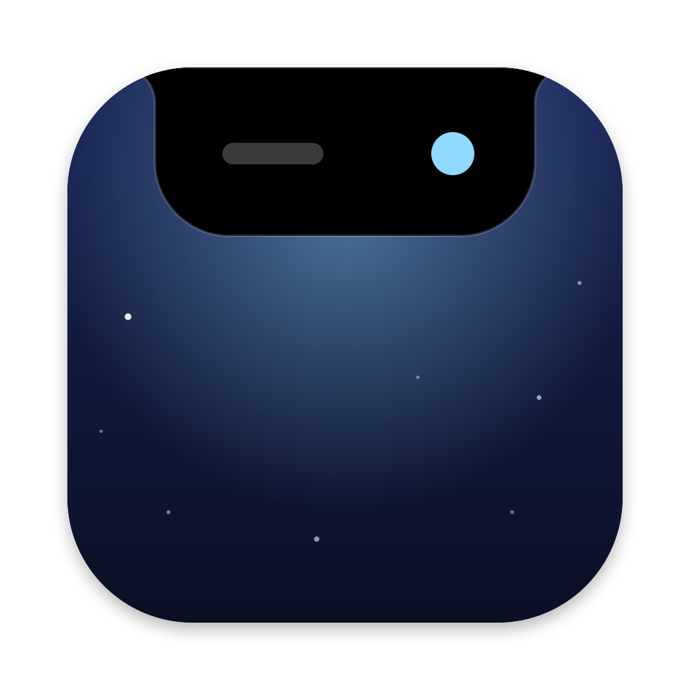
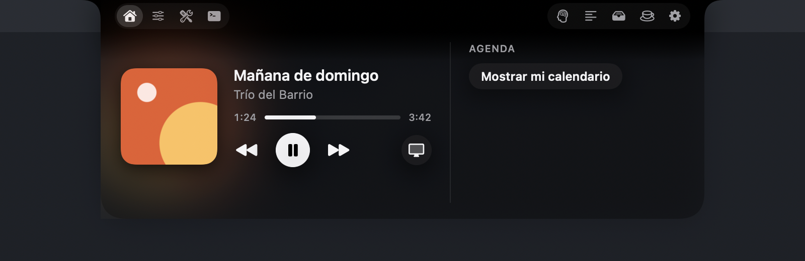
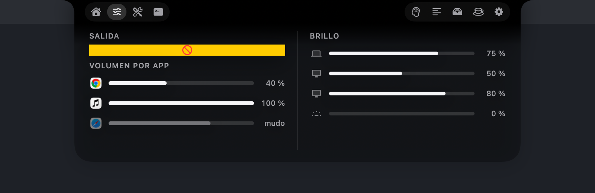
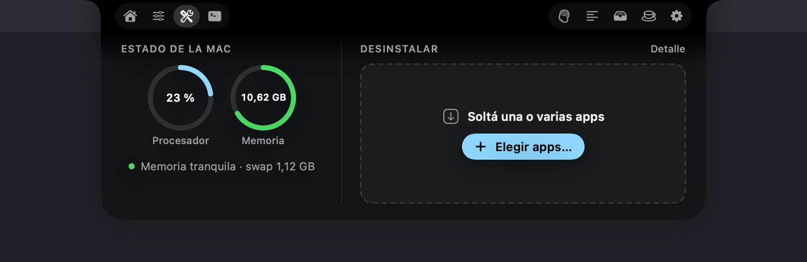
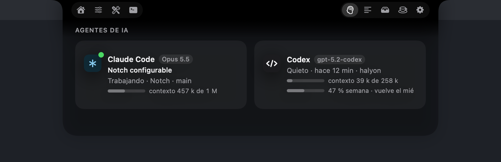
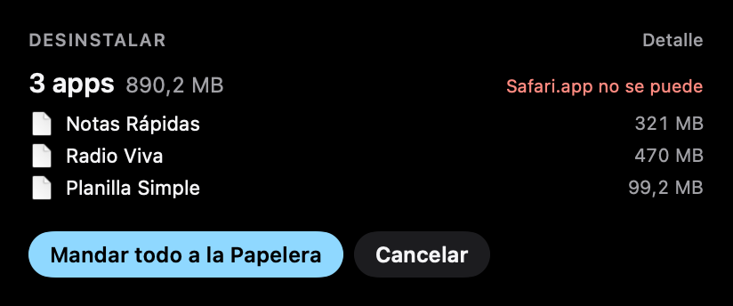
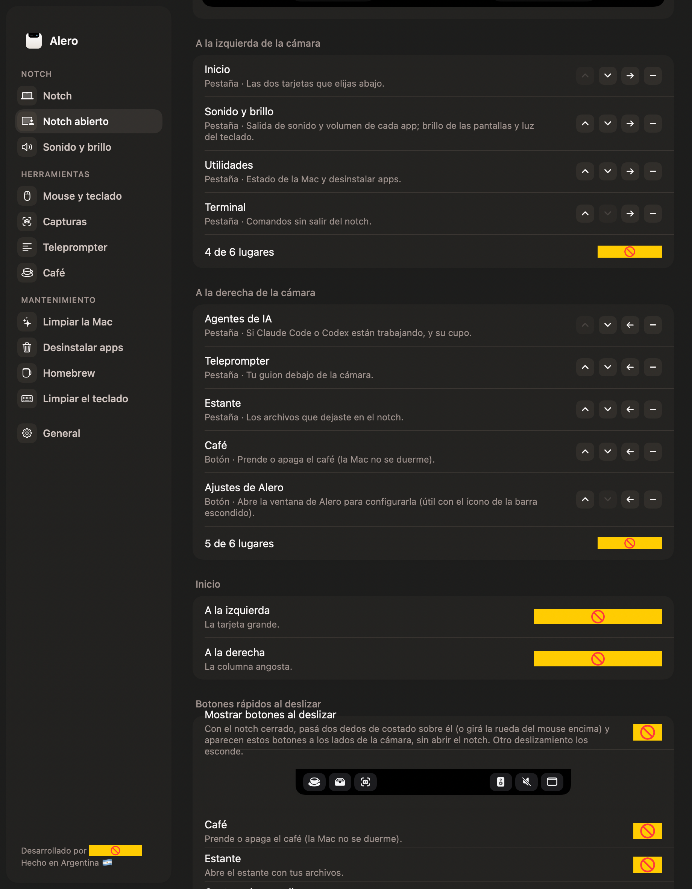

<p align="center"></p>

<h1 align="center">Alero</h1>

<p align="center"><b>Your Mac's notch, put to work.</b><br>
A native macOS app for the menu bar and the notch: music, calendar, per-app volume, display brightness, a teleprompter,
screenshots, cleanup and uninstall tools — light, private and open source.</p>

<p align="center"><a href="https://alero.halyon.app">Website</a> · <a href="https://github.com/Halyon85/alero/releases/latest">Download</a> · 🇦🇷 <b><a href="LEEME.md">Leer en español</a></b></p>

---

| Home | Sound & brightness | Utilities |
|---|---|---|
|  |  |  |

| AI agents | Uninstall several apps | Settings |
|---|---|---|
|  |  |  |

## What it does

**The notch**
- **Closed:** looks like the real notch. Shows the album art while music plays, a small cup while *Coffee* keeps the Mac
  awake, and short notices beside the camera: volume and brightness (instead of the macOS overlay), headphones
  connected, charger plugged in with the battery level, a download finished, a meeting in 5 minutes.
- **Open:** fully configurable. Tabs and buttons go on either side of the camera, in the order you choose:
  - **Home** — two cards of your choice (music, calendar, sound, Mac status, AI agents).
  - **Sound & brightness** — output device, per-app volume, every display's brightness and the keyboard light.
  - **Utilities** — CPU and memory pressure, and an uninstaller: pick several apps (or drop them) and send them, with
    everything they left behind, to the Trash in one go.
  - **Clean up** — caches, old logs, Xcode leftovers, Homebrew downloads, old installers and forgotten screenshots.
  - **AI agents** — whether Claude Code or Codex are working right now, the active chat, model and context used, and
    Codex's weekly quota. Read from their local logs: no keys, no network.
  - **Teleprompter** — your script right under the camera, at a fixed speed or **following your voice** (Spanish,
    on-device when available). Hidden from screen sharing and recordings.
  - **Terminal** — run commands without leaving the notch.
  - **Shelf** — drop files on the notch and take them anywhere later.
- **Background:** black or frosted glass, with the transparency you like. Resizable.

**Also**
- **Screenshots** with a shortcut: area, window (with its shadow) or full screen, frozen screen and magnifier, an
  editor (crop, arrow, box, highlighter, text) and pinned screenshots.
- **Per-app volume** and **display brightness** for regular monitors (DDC, or software dimming when they don't support it).
- **Keyboard light** with ⌘ + the brightness keys.
- **Coffee:** keep the Mac awake for a while or until you turn it off — optionally even with the lid closed.
- **Clean the keyboard:** locks keyboard and trackpad so you can wipe them.
- **Homebrew:** what you installed, what has updates, live output while updating.
- **Mouse & keyboard:** smooth or reversed wheel scrolling, click a Dock icon to minimize (or go to the next window),
  green button to maximize, mouse buttons 3–5 with actions, cut and paste files in Finder.

Every feature can be turned off and, when off, does nothing in the background. Idle: ~20 MB of memory, 0 % CPU.

## Requirements

- macOS 14 or later, Apple Silicon or Intel (the download is universal; `compilar.sh` builds for Apple Silicon, `ALERO_UNIVERSAL=1 ./compilar.sh` for both).
- To build: the Xcode Command Line Tools (`xcode-select --install`) and `cmake` (`brew install cmake`, for the music reader).

## Download

Get the latest `Alero-x.y.z.zip` from [Releases](https://github.com/Halyon85/alero/releases/latest), unzip it and drag
`Alero.app` to Applications.

> ⚠️ **Install at your own risk.** Alero is free, open source software without any warranty (see the [license](LICENSE)).
> Since 0.1.5 it's signed with an Apple Developer ID and notarized by Apple, so it opens normally. Some features use parts of
> macOS that Apple doesn't document (keyboard light, built-in display brightness, what's playing); if a macOS update
> changes them, those features turn themselves off.

If you'd rather not trust a download, build it yourself from this code: it takes a minute.

## Build and install

```bash
git clone https://github.com/Halyon85/alero.git && cd alero
./compilar.sh            # builds build/Alero.app
./compilar.sh instalar   # also copies it to /Applications and opens it
swift test               # tests (no permissions needed, they never touch your files)
```

You don't need an Apple developer account: `compilar.sh` signs with your "Apple Development" certificate if you have
one, or ad hoc otherwise. `ALERO_SIN_MUSICA=1 ./compilar.sh` builds without the music reader.

## Permissions

Alero asks only when a feature needs it, and everything else keeps working without it.

- **Accessibility:** mouse and keyboard features, volume and brightness keys.
- **Screen Recording:** screenshots only. Images stay on your Mac.
- **System Audio Recording:** to lower one app's volume (its sound is played back quieter; nothing is recorded or saved).
- **Calendar:** the calendar card. Events never leave your Mac.
- **Microphone and Speech Recognition:** only for the teleprompter's voice mode, while it's running.
- **Finder automation:** cut and paste files, and hand Finder what needs an administrator password.
- **Administrator password (once):** only if you turn on *Coffee with the lid closed*. It installs a rule that lets
  Alero run exactly two commands (`pmset -a disablesleep 1` and `0`); you can remove it from Settings › Coffee.

## Privacy

Alero has no accounts, no analytics and makes no network requests of its own. Everything it reads stays on your Mac.

## Credits

- Some ideas come from other open source notch and utility apps — [Boring Notch](https://github.com/TheBoredTeam/boring.notch),
  [Atoll](https://github.com/Ebullioscopic/Atoll) and [Vorssaint Utils](https://github.com/vorssaint/vorssaint-utils). No code was copied: Alero is written from scratch.
- Music reader: [MediaRemote Adapter](https://github.com/ungive/mediaremote-adapter) (BSD 3-Clause), bundled unmodified in `Vendor/`.

## License

The code is licensed under the [Apache License 2.0](LICENSE). Redistributions must keep the [`NOTICE`](NOTICE) file
and its credit. The name "Alero", its logo and icon are not licensed — see [TRADEMARKS.md](TRADEMARKS.md).
Contributions are welcome: [CONTRIBUTING.md](CONTRIBUTING.md). Security reports: [SECURITY.md](SECURITY.md).

---

<p align="center">Made by <a href="https://halyon.team"><b>Halyon Team</b></a> · Made in Argentina 🇦🇷</p>
